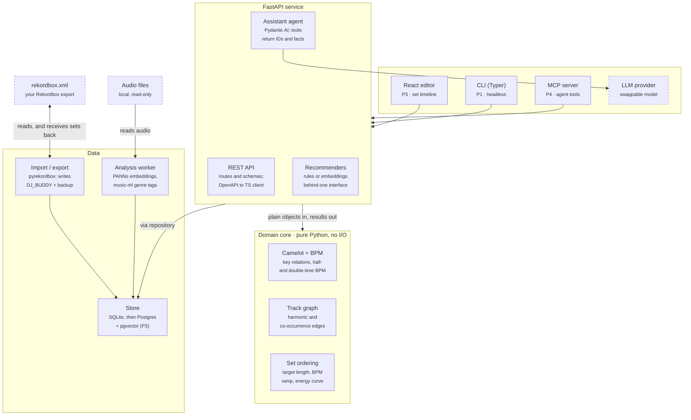
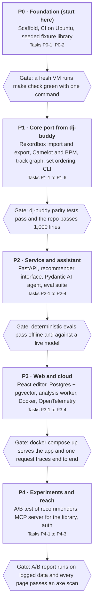

# DJ Set Planner: Architecture

> Snapshot of the architecture doc as of 2026-11-18, by Carlos Zamora. [ROADMAP.md](../ROADMAP.md)
> is the live task tracker; the status column below is not kept up to date.

The DJ set planner is one FastAPI service on Postgres, a background worker for audio analysis, and
a React set editor. The recommender and the LLM assistant sit behind interfaces, so each task
changes one module and proves it with tests. The code lives in the dj-buddy-python repo as
the `djbuddy` package and CLI, a Python successor to the C# dj-buddy.

## Architecture



*One service over a pure core, so most tests need no database or LLM.*

The CLI, the React editor and later MCP clients all call one service layer. The service loads
tracks through a repository, passes plain objects to the pure core, and returns results. The
assistant reaches the core only through tools.

**Key decisions**

- **Modular monolith.** One deployable app with clear module boundaries. Split a module out only
  when a metric demands it, such as analysis jobs slowing requests.
- **Rekordbox stays the source of truth.** BPM, key and cue points come from your Rekordbox
  export. The app never writes to master.db; it writes sets back as a `DJ_BUDDY` folder in
  rekordbox.xml, after a backup, as [dj-buddy](https://github.com/carlos-zamora/dj-buddy) does
  today.
- **Pure core, ported from dj-buddy.** Camelot relations, half- and double-time BPM matching, the
  track graph and set ordering move from C# to Python. dj-buddy's existing test cases become
  parity tests.
- **Swappable recommenders.** A rules recommender (the harmonic graph) and an embedding
  recommender (PANNs vectors from [music-ml](https://github.com/carlos-zamora/music-ml)) share one
  interface, so the A/B test is configuration, not a rewrite.
- **Give the assistant access, not intelligence.** Tools return track IDs and facts;
  deterministic code does the BPM maths and ordering. This is the lesson from
  [wt-mcp](https://github.com/carlos-zamora/wt-mcp), and it keeps the
  assistant testable.
- **Runs without your music or an API key.** A seeded fixture library (synthetic rekordbox.xml
  plus precomputed embeddings) and a fake model let every test run on a fresh Linux VM.
- **No Spotify dependency.** Spotify closed audio features, audio analysis and recommendations to
  new apps on 27 November 2024
  ([Spotify](https://developer.spotify.com/blog/2024-11-27-changes-to-the-web-api)), so features
  come from Rekordbox and local analysis.

## Foundation

Set this up once (task P0-1) so every task starts from a green build on a fresh Linux VM.

```text
dj-buddy-python/
├── src/djbuddy/
│   ├── core/        # pure: camelot, bpm, graph, ordering, models
│   ├── ingest/      # rekordbox.xml import and export
│   ├── store/       # SQLAlchemy models and repositories
│   ├── analysis/    # embeddings and genre tags (from music-ml)
│   ├── recommend/   # Recommender interface, rules, similarity, experiments
│   ├── assistant/   # agent, tools, prompts
│   ├── api/         # FastAPI app, routers, schemas
│   ├── config.py    # pydantic-settings, reads .env
│   └── cli.py       # Typer entry point
├── web/             # React + Vite (Phase 3)
├── migrations/      # Alembic versions
├── tests/{unit,integration,evals,fixtures}/
├── docs/architecture.md   # hard copy of this doc
├── scripts/check.ps1      # make check for Windows
├── CLAUDE.md        # rules for AI coding agents (AGENTS.md points here)
├── ROADMAP.md       # live task tracker
├── LICENSE          # MIT
├── Makefile         # make check = ruff + mypy + pytest
└── pyproject.toml   # uv, ruff, mypy, pytest config
```

- **Portable:** MIT license, Python, runs on Linux. The core port alone passes 1,000 lines.
- **One-command setup:** `uv sync && uv run djbuddy demo` loads the fixture library. CI runs
  `make check` on ubuntu-latest.
- **Python 3.12, typed:** `mypy --strict` on `core/` and `recommend/`, looser elsewhere.
- **Config:** pydantic-settings reads `.env` (database URL, model name, library path), as music-ml
  does today.
- **Rules in CLAUDE.md:** never write to master.db; never commit audio, your library or API keys;
  one behaviour per change; every task ends with `make check` green and a new test that failed
  before the change.

## Packages

Every choice favours what you already know (SQLAlchemy, Alembic, PyTorch from music-ml) and what
AI coding models handle well. Pin exact versions in `uv.lock`.

| Layer | Choice | Why | Alternatives (switch when) |
| --- | --- | --- | --- |
| Tooling | uv, ruff, mypy | One lockfile and one fast linter; setup is one command | Poetry; pyright for faster type checks |
| Rekordbox | [pyrekordbox](https://pypi.org/project/pyrekordbox/) (MIT) | Reads and writes rekordbox.xml; tested on Rekordbox 5.8.6 to 7.0.9 | Port dj-buddy's parser on lxml (full control, more code to own) |
| Graph | networkx | Readable, and models know it well | rustworkx when graph builds get slow; igraph |
| API | FastAPI + Pydantic | Typed schemas produce OpenAPI, which produces the TypeScript client | Django + Django Ninja if you want admin and auth built in; Litestar |
| Database | SQLAlchemy 2 + Alembic on SQLite, then Postgres | Same stack as music-ml; no server needed until Phase 3 | SQLModel for less boilerplate |
| Vector search | numpy in memory, then pgvector | A personal library fits in memory | sqlite-vec to stay on SQLite; Qdrant at much larger scale |
| Audio features | PANNs embeddings and the music-ml genre model | Already built and evaluated in music-ml | Essentia models (Linux wheels only); CLAP for text-to-audio search |
| LLM agent | Pydantic AI (2.x) | Model-agnostic, typed tools and outputs, built-in test model for offline tests | Anthropic or OpenAI SDK directly for fewer layers; LangGraph for long multi-step flows |
| Evals | pydantic-evals + pytest | Datasets and custom evaluators in plain Python | promptfoo; DeepEval; Inspect |
| Jobs | CLI batch first, then arq + Redis | arq is async and small, a fit for FastAPI | Celery (most common, heavier); Procrastinate to avoid Redis |
| CLI | Typer + Rich | Same feel as music-ml's Rich output | Click |
| Front end | React + TypeScript + Vite, TanStack Query, dnd-kit | Covers skill 5; dnd-kit supports keyboard drag | HTMX + Jinja keeps it all Python if TypeScript slows you down; Next.js |
| API client | openapi-typescript | Types come from the API, never typed by hand | orval; Hey API |
| Observability | OpenTelemetry SDK, Grafana (otel-lgtm image) | Vendor-neutral and free locally; your telemetry background shows | Logfire (least setup); Datadog |
| Auth (Phase 4) | Authlib (OAuth/OIDC) | Standard login without running a user database of passwords | A hosted provider such as Auth0 or Clerk |

Not used: the Spotify Web API, for the reason in Architecture.

## Testing plan

Most tests hit the pure core, so they run in seconds with no database, audio or network. CI blocks
a merge on every layer marked "every push".

| Layer | What it proves | Tools | When it runs |
| --- | --- | --- | --- |
| Unit (core) | Camelot relations, BPM tiers, graph edges and ordering invariants (a set is a permutation; same seed, same order) | pytest, hypothesis | Every push |
| Parity | Python gives the same answers as dj-buddy for key conversion, graph building and set ordering | Cases ported from dj-buddy's `Rekordbox.Tests` | Every push |
| Ingest round trip | Import, export, re-import loses nothing; a second import adds no rows | dj-buddy's `minimal.xml` and `round_trip.xml` fixtures | Every push |
| API and database | Endpoints, error model, Alembic upgrade and downgrade | httpx with FastAPI's TestClient on a temp SQLite file; testcontainers Postgres from Phase 3 | Every push |
| Recommender replay | Hit rate at 10 for the real next track in past sets | Replay script with a stored baseline; fixture history sets on the VM, your Rekordbox history locally | When `recommend/` changes; fails below baseline |
| Assistant evals | Only real track IDs; set length within 1 of the ask; BPM ramp respected; at least 80% harmonic transitions to start; no repeats | pydantic-evals; the test model offline, a live model nightly | Deterministic checks gate; a judge score for "fits the brief" is reported only |
| UI | Components, keyboard-only reorder, an axe scan of each page | Vitest, Testing Library, Playwright, your accessibility MCP server | Every push from Phase 3 |

- **Coverage:** 90% of lines in `core/` and `recommend/`; no target elsewhere.
- **No secrets in CI:** unit and integration tests never call a real model. Live evals read a key
  from a GitHub secret and run on a schedule.
- **Every task adds a test** that fails before the change and passes after, so each change has a
  check to review against.

## Roadmap



*Five phases, each closed by a gate you can check. Not to scale; task IDs match the tracker below.*

P0 and P1 alone give a 1,000-line Python repo with real tests; later phases add the API,
assistant, web and cloud skills in that order.

## Tasks

Each task is scoped so one round cannot finish it. Round 1 builds the happy path; later rounds add
edge cases, tests and refactors from your review of the diff. "Done when" is a check you can run.
Work them in ID order; IDs match the roadmap phases.

| ID | Task | Rounds | Done when | Status |
| --- | --- | --- | --- | --- |
| P0-1 | Scaffold and CI | R1 uv project, ruff, mypy, pytest · R2 GitHub Actions on Ubuntu, Makefile · R3 CLAUDE.md rules, README quickstart | Fresh VM: `uv sync && make check` is green | In progress |
| P0-2 | Fixture library generator | R1 seeded generator for a 300-track rekordbox.xml · R2 playlists and history sets with realistic key and BPM mixes · R3 fixture embeddings, `djbuddy demo` | Same seed gives an identical file; demo loads it | Not started |
| P1-1 | Rekordbox import | R1 parse tracks and playlists with pyrekordbox · R2 persist with SQLAlchemy and Alembic, idempotent · R3 port dj-buddy fixtures and edge cases (missing key, unicode paths) | Two imports in a row add no rows; fixtures pass | Not started |
| P1-2 | Camelot and BPM core | R1 port CamelotWheel and HarmonicRelation · R2 BPM tiers with half and double time · R3 hypothesis properties and dj-buddy parity cases | Parity cases pass; properties hold over 1,000 examples | Not started |
| P1-3 | Track graph | R1 harmonic edges in networkx · R2 playlist co-occurrence edges and weights · R3 suggest-next and find-similar, timed on 10,000 fixture tracks | Answers match dj-buddy on fixtures; under 200 ms per query | Not started |
| P1-4 | Set ordering | R1 port TrackSetOrdering · R2 target length, BPM ramp, energy curve · R3 a 2-opt improvement pass | Output is a permutation; transition score never below the greedy order | Not started |
| P1-5 | Rekordbox export | R1 write the DJ_BUDDY folder · R2 backup and atomic write · R3 round-trip test, then a manual import in Rekordbox | Round trip loses nothing; Rekordbox opens the file | Not started |
| P1-6 | CLI | R1 import, suggest, order, export commands · R2 Rich tables and a `--json` flag · R3 CliRunner snapshot tests | Every command has a test | Not started |
| P2-1 | FastAPI service | R1 library and track endpoints · R2 sets and recommendations · R3 error model, OpenAPI snapshot, integration tests | OpenAPI snapshot is stable; tests green | Not started |
| P2-2 | Recommender interface | R1 interface plus the rules recommender · R2 embedding recommender on fixture vectors · R3 replay eval comparing both | Replay report committed; both beat a random baseline | Not started |
| P2-3 | Assistant agent | R1 agent with dj-buddy's library and workspace tools · R2 SetPlan structured output, validation, retries · R3 streaming endpoint, offline tests | Tests pass with no API key | Not started |
| P2-4 | Assistant eval suite | R1 30-case dataset and deterministic evaluators · R2 LLM judge and HTML report · R3 CI job that gates on the deterministic score | Baseline stored; CI fails on a regression | Not started |
| P3-1 | React set editor | R1 Vite + TypeScript, generated client, library table · R2 set timeline with keyboard reorder and harmonic colours · R3 Playwright E2E and axe scan | A keyboard-only user can build and save a set | Not started |
| P3-2 | Postgres, pgvector, Docker | R1 Compose with Postgres, Alembic on Postgres · R2 pgvector similarity replaces numpy · R3 testcontainers tests and a speed comparison | `docker compose up` serves the app; tests green | Not started |
| P3-3 | Analysis worker | R1 arq job computes embeddings · R2 idempotency keys, retries with backoff, dead-letter list · R3 progress endpoint and tests | Killing the worker mid-job loses no work | Not started |
| P3-4 | OpenTelemetry | R1 traces for FastAPI and SQLAlchemy · R2 spans for recommender and LLM calls (tokens, latency) · R3 Grafana dashboard committed as JSON | One request shows end to end in Grafana | Not started |
| P4-1 | A/B test of recommenders | R1 deterministic assignment by session hash · R2 log shown and accepted suggestions · R3 report with confidence intervals | Report runs on logged fixture data | Not started |
| P4-2 | MCP server for the library | R1 read-only library tools · R2 set tools that return proposed sets instead of writing · R3 in-memory client tests | Works from VS Code and Claude Desktop | Not started |
| P4-3 | Auth | R1 OAuth login with Authlib · R2 per-user libraries · R3 permission tests | One user cannot read another's sets | Not started |

## Sources

- [dj-buddy](https://github.com/carlos-zamora/dj-buddy) and
  [music-ml](https://github.com/carlos-zamora/music-ml): your repos, read 18 November 2026 (README,
  file layout, tests)
- [pyrekordbox on PyPI](https://pypi.org/project/pyrekordbox/): version 0.5.0, MIT, XML read and
  write, tested Rekordbox versions
- [Spotify: Introducing some changes to our Web API](https://developer.spotify.com/blog/2024-11-27-changes-to-the-web-api):
  endpoints closed to new apps
- [Pydantic AI v1 announcement](https://pydantic.dev/articles/pydantic-ai-v1): notes that 2.0
  shipped on 23 June 2026
- Project idea and follow-on tasks: the Project ideas table in your
  [Target Companies Report](https://claude.ai/artifact/3iZgv9HsEHwPqHfJbgeGet)
